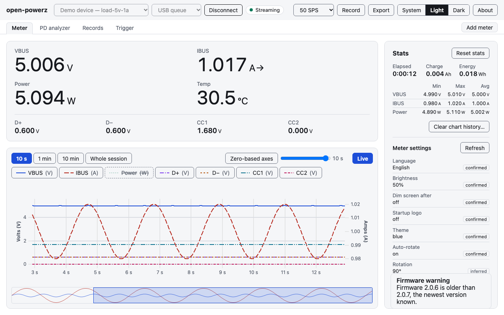

# open-powerz

An open-source, cross-platform (macOS, Linux, Windows) desktop app and CLI for the
ChargerLAB **POWER-Z KM003C / KM002C** USB-C power meter and PD analyzer. It covers
the features of the vendor's Windows-only "POWER-Z Lab" PC software with a modern UI.

> **Unofficial project.** open-powerz is not made, endorsed or supported by ChargerLAB.
> "POWER-Z" and "ChargerLAB" are trademarks of their owner. For the official software,
> manuals and firmware, see the
> [POWER-Z technical support page](https://www.power-z.com/blogs/technical-support/power-z-km003c-km002c-technical-support).

**Status:** the desktop app and the `powerz` CLI work and are tested on a real KM003C.
The KM002C should work the same way but is untested. Release builds are not signed yet.



## Install

Download the desktop app or the `powerz` CLI for macOS, Windows or Linux from the
[latest release](https://github.com/nesquikm/open-powerz/releases/latest). The builds
are not signed yet; [Install a release](docs/how-to/install-a-release.md) shows how to
check the download and open the app past the macOS and Windows warnings.

## Features

### Live meter

- See VBUS, IBUS, power, D+, D−, CC1, CC2 and temperature in a big live readout, in a light, dark or system theme ([getting started](docs/tutorials/getting-started.md#the-desktop-app))
- Pick a meter or the demo device; the app reconnects on its own after an unplug or a page reload and marks the gap ([explore a session](docs/how-to/explore-a-session.md#when-the-meter-is-unplugged-and-plugged-back-in))
- Use it from the keyboard and with a screen reader ([keyboard and screen readers](docs/how-to/explore-a-session.md#keyboard-and-screen-readers))

### Recorder and charts

- Chart VBUS, IBUS, power, D+, D−, CC1 and CC2 live, with per-series toggles ([explore a session](docs/how-to/explore-a-session.md))
- Pause the chart, then zoom and pan with the overview strip, wheel, trackpad, J/K/L or presets ([move around](docs/how-to/explore-a-session.md#move-around-a-long-session))
- Read the whole session at once, with gaps shown as "No data" bands ([whole session](docs/how-to/explore-a-session.md#read-the-whole-session))
- See min, max, average, charge and energy for the session ([statistics](docs/how-to/record-a-csv.md#reset-the-statistics-or-clear-the-chart-history))
- Record to CSV at up to 1000 samples/s in the vendor's layout, from the app or `powerz stream`, and reveal the file in one click ([record a CSV](docs/how-to/record-a-csv.md))

### PD analyzer

- Capture USB PD traffic and read each message decoded by a USB PD 3.2 decoder, with its fields and raw bytes ([analyze PD traffic](docs/how-to/analyze-pd-traffic.md))
- Filter the packet table by GoodCRC, type and SOP, and follow new messages as they arrive ([analyze PD traffic](docs/how-to/analyze-pd-traffic.md))
- See PD messages as markers on the power chart, linked both ways with the table ([analyze PD traffic](docs/how-to/analyze-pd-traffic.md))
- Save and open captures as `.pdcap` files, and import the vendor's PD log database ([pdcap format](docs/reference/pdcap.md))

### Protocol triggers

- Detect which fast-charge protocols a charger speaks ([trigger a charger](docs/how-to/trigger-a-charger.md))
- Trigger 9 V from a PD charger, or any fixed, PPS or EPR AVS voltage it offers, from the desktop trigger panel or the CLI, with a confirmation above 5 V and a way back to 5 V ([trigger a charger](docs/how-to/trigger-a-charger.md))
- Trigger QC 2.0/3.0, FCP, AFC, SFCP, SCP, VFCP, TFCP and UFCS chargers ([CLI triggering](docs/reference/cli.md#protocol-triggering))
- Send custom PD messages, read a cable's e-marker, or type raw commands in a console ([custom PD messages](docs/reference/cli.md#custom-pd-messages))

### Firmware update

- See the meter's mode and firmware version, with a warning for old firmware ([CLI reference](docs/reference/cli.md))
- Inspect a ChargerLAB firmware file before you use it ([update firmware](docs/how-to/update-firmware.md))
- Update the meter's firmware from the CLI or behind the app's Advanced firmware switch, with recovery steps if it fails ([update firmware](docs/how-to/update-firmware.md))

### Offline records

- Download the recordings the meter made on its own as CSV, and open one in the chart with its statistics ([read the meter's memory](docs/how-to/read-the-meters-memory.md))

### Meter settings

- View the meter's settings and calibration values, read-only ([read the settings](docs/how-to/read-the-meters-memory.md#read-the-settings))

### Serial stream

- Stream at 50 or 1000 samples/s over the meter's virtual serial port, with no sign-in ([serial-port stream](docs/how-to/record-a-csv.md#record-the-serial-port-stream-instead))

### Several meters

- Connect several meters at once and watch them in a grid of tiles, each with its own recording ([use several meters](docs/how-to/use-several-meters.md))

### CLI

- Script the meter with `powerz`: list, info, read, watch and stream, with JSON output, raw frame traces and stable exit codes ([CLI reference](docs/reference/cli.md))
- Build your own tools on the `powerz-protocol` Rust library and the documented USB protocol ([API](docs/reference/api/powerz-protocol.md), [protocol](docs/protocol.md))

### Demo device and simulator

- Try everything without a meter on the demo device, with named scenarios and fault injection for tests ([try it without a meter](#try-it-without-a-meter))

### Releases

- Download unsigned installers for macOS (.dmg), Windows (.msi, .exe) and Linux (AppImage, .deb) and the CLI, checked with SHA256SUMS ([install a release](docs/how-to/install-a-release.md))

## Coming next

- Deleting offline records and changing meter settings from the app
- Polish across the app
- A browser edition for Chrome and Edge, hosted on GitHub Pages

## Layout

| path | what |
|---|---|
| `crates/powerz-protocol` | Rust protocol library: transports (vendor bulk, HID, CDC), framing, decoders |
| `crates/powerz-record` | vendor-compatible CSV recorder shared by the CLI and the desktop app |
| `crates/powerz-cli` | `powerz` command-line tool |
| `apps/desktop` | Tauri 2 desktop app (Svelte 5 + TypeScript + Vite, uPlot charts) |
| `specs/` | requirements, technical spec, plans |

The USB protocol the meter speaks is documented in [docs/protocol.md](docs/protocol.md).

## Building

Requirements: Rust from [rustup](https://rustup.rs), [Bun](https://bun.sh), and the
[Tauri 2 system prerequisites](https://v2.tauri.app/start/prerequisites/) for your OS.
rustup installs the exact Rust version pinned in `rust-toolchain.toml` at the repo
root. The minimum supported Rust stays 1.96 (`rust-version` in `Cargo.toml`).

```bash
bun install
bun run build:web             # build the web UI (the Tauri crate embeds it)
cargo build --workspace       # library, CLI and desktop app
cargo run -p powerz-cli       # the CLI
bun run dev                   # desktop app with hot reload
```

### Rust toolchain

The Rust version is pinned in one place: `rust-toolchain.toml`. CI and release
builds use the same file and never name their own version; the gate fails if a
workflow does.

To move to a newer Rust:

1. Edit `channel` in `rust-toolchain.toml`.
2. Fix any new clippy lints and `cargo fmt` changes.
3. Open a pull request.

A Homebrew-installed `rust` (cargo not managed by rustup) ignores
`rust-toolchain.toml`. Put rustup's proxies first on your `PATH` instead, for
example `brew install rustup` and add `$(brew --prefix rustup)/bin` before
Homebrew's `bin`.

## Try it without a meter

The `powerz` CLI ships a simulated KM003C, the **demo device**:

```bash
cargo run -p powerz-cli -- --transport sim info
cargo run -p powerz-cli -- --transport sim --scenario load-5v-1a read
cargo run -p powerz-cli -- list --include-demo
```

Scenarios: `idle`, `load-5v-1a`, `pd-9v-2a`, `noisy-negative`. For tests, the
simulator also reads `POWERZ_SIM_CLOCK=fake` (deterministic simulated time),
`POWERZ_SIM_FAULT` (e.g. `timeout@2,disconnect@3,wrong-id@4,permission`) and
`POWERZ_SIM_CTRL_C_AFTER=N` (act as if Ctrl-C was pressed after N polls).

Hardware-in-the-loop tests against a real meter run only with `POWERZ_HIL=1`:

```bash
POWERZ_HIL=1 cargo test -p powerz-cli --test hil
```

## License

MIT, see [LICENSE](LICENSE). The repository ships the AES keys the meter uses for
authenticated features (queue streaming, device info, offline records), so those work
without extra setup.
